# d2-team-stats

A Dota 2 dashboard for a player and the people they party with: what works and what doesn't when
they play together. Track as many players as you like and switch between them in the header; each
gets a view of their own, with party mates found automatically.

Data comes straight from Valve (Steam Web API and the dota2.com data feeds) into a local SQLite
database. There's no third-party stats service in the loop.

## Features

The screenshots show the view for **Aui_2000** (TI5 champion, public match data) and the party mates
detected for them. Regenerate them with `pnpm screenshots`.

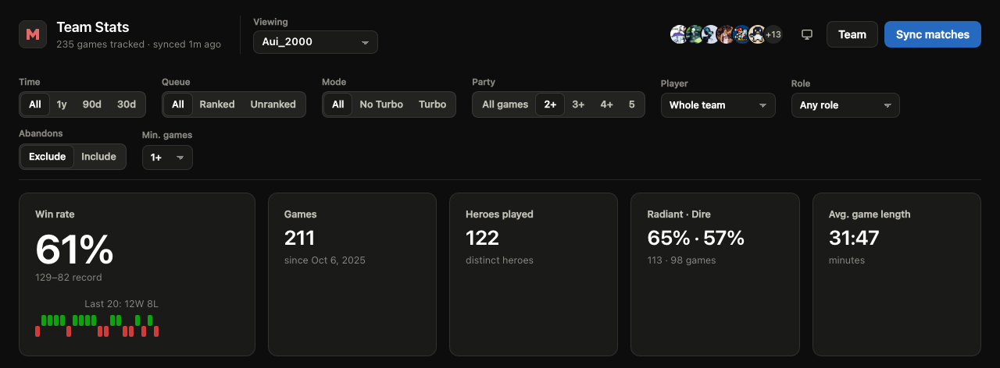

**Switch between players** with the **Viewing** menu. Every chart and table follows one row of
filters: time range, ranked/unranked, Turbo, party size, a single player, a role, games with
abandons, and a minimum number of games per row.

### Key insights

Plain-language findings, such as "Aui_2000 on safe lane: 74% win rate over 65 games, vs 55% in other
roles". Each one compares a group of games with the rest using a two-proportion test. Findings that
survive a false-discovery-rate correction are marked strong; the rest are marked possible.

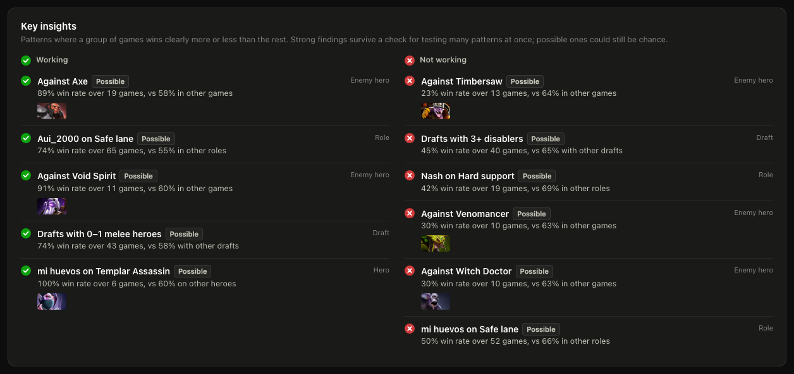

### Players, roles and lineups

Each player's record, averages, most played heroes and usual role. Roles (safe lane, mid, offlane,
soft and hard support) are inferred for every game (see [How roles are inferred](#how-roles-are-inferred)).
Click a cell to focus the whole dashboard on that player in that role. Lineups show which exact
groups of players win together.

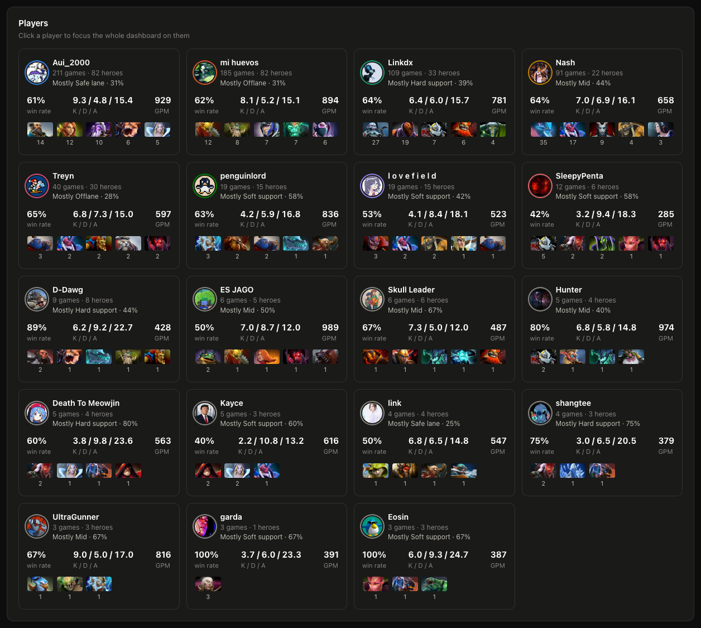
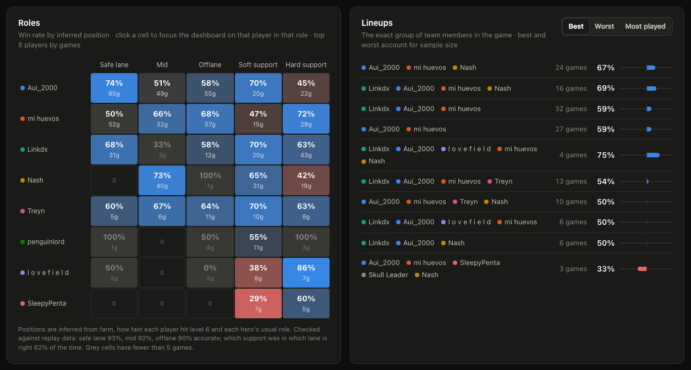

### Heroes

The hero pool with win rate, record, usual role and who plays each hero; hero pairs that win
together; and the enemy heroes the team struggles against or beats, ranked with sample size
taken into account.

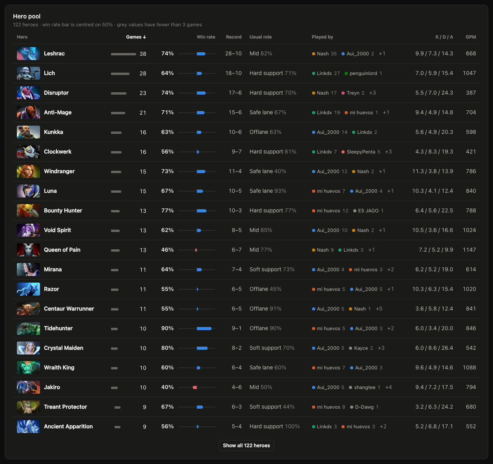
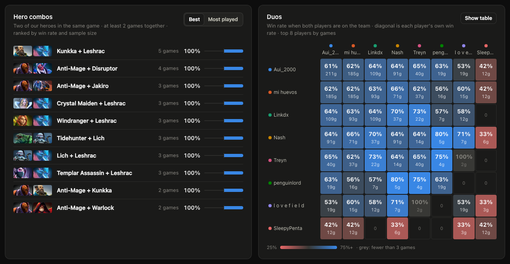
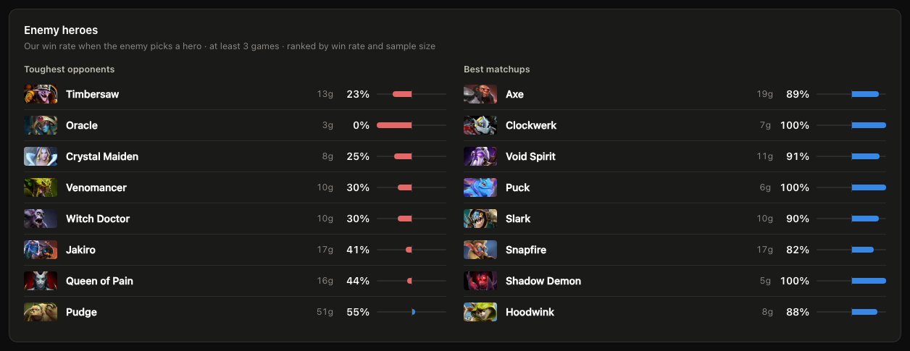

### What changes when you lose, and comfort picks

Each player's deaths, kills, assists, GPM, last hits and hero damage in wins vs losses, with the
biggest swing highlighted, and their win rate on their 5 most played heroes vs everything else.

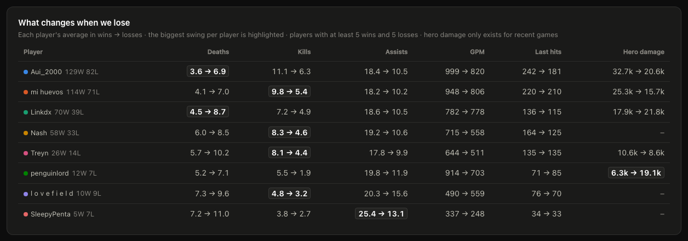
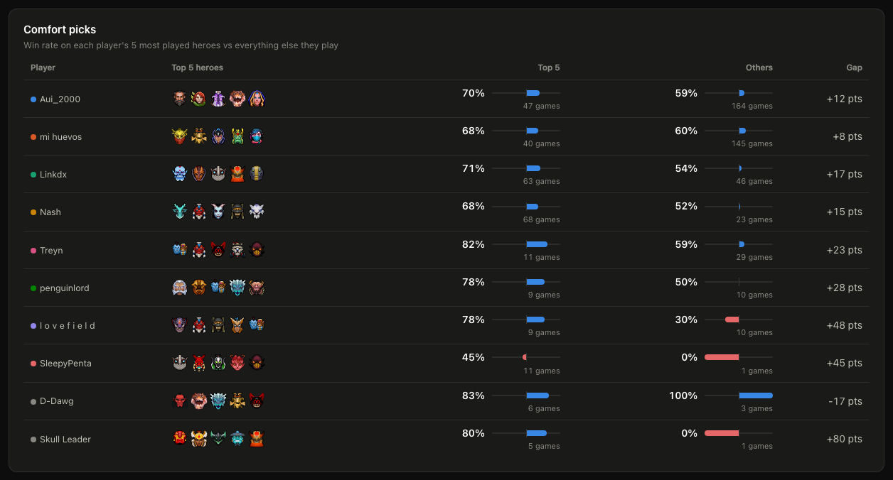

### Draft, game length, sessions and form

Win rate by draft composition (using Valve's hero role ratings), game length, party size, game
number in a session, previous result, time of day, day of week, and month by month.

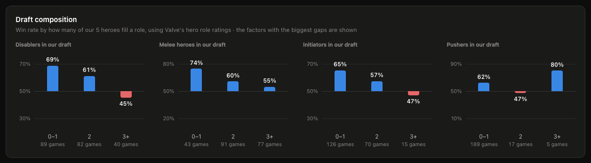
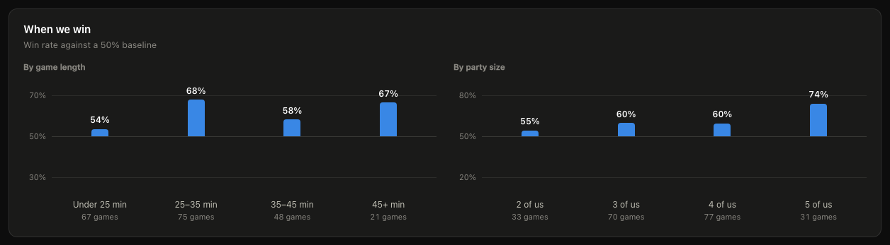
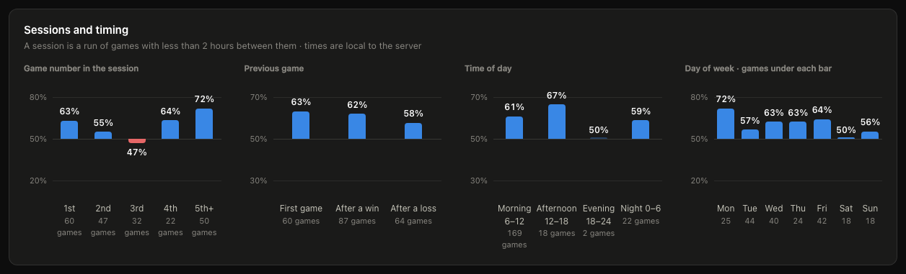
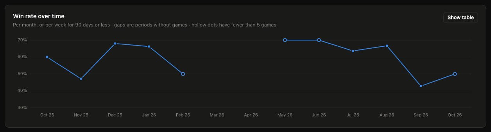

### Recent matches

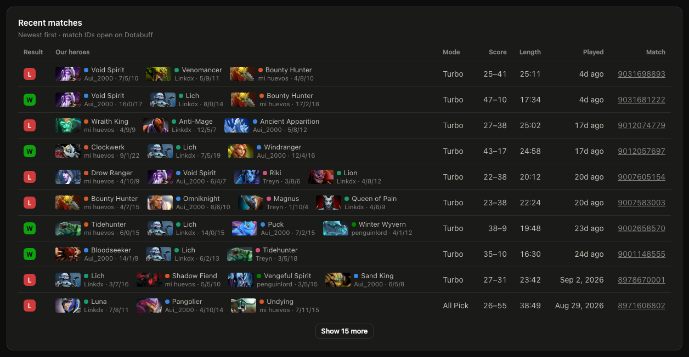

### Party detection, light theme and phones

Party mates with public match data are added automatically and marked `auto`. The dashboard follows
the system theme (or pick one in the header) and works on a phone.

<p>
  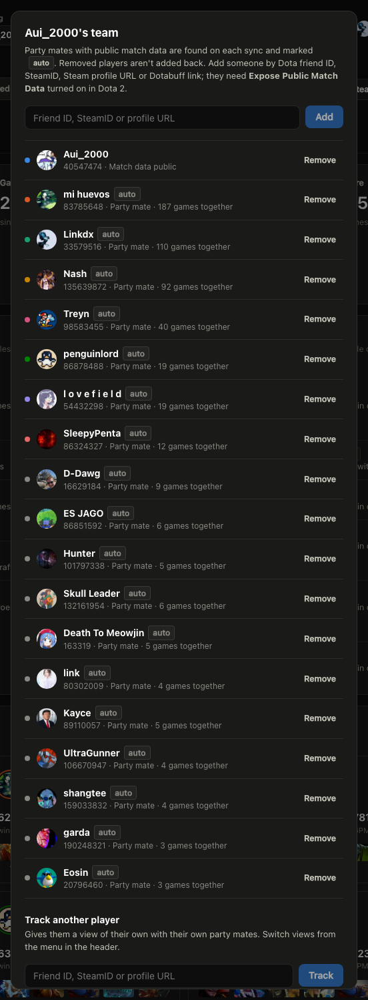
  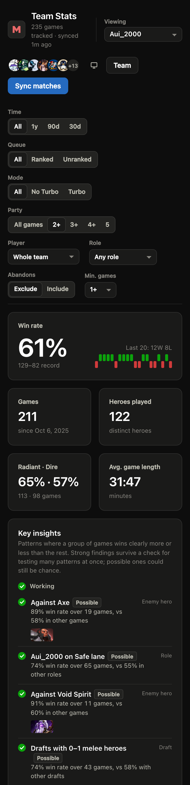
</p>

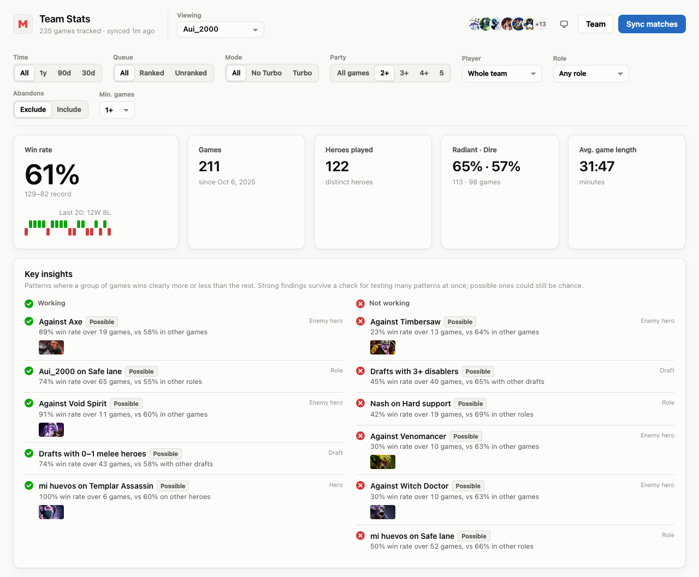

## Setup

Requires Node 24+ and pnpm.

```sh
pnpm install
echo "STEAM_API_KEY=<your key>" > .env   # https://steamcommunity.com/dev/apikey
pnpm dev                                  # API on :3001, dashboard on http://localhost:5173
```

Open the dashboard and add a player (friend ID, SteamID, Steam profile URL or Dotabuff link).
Their games sync straight away and their party mates are added automatically. To track someone
else, open **Team → Track another player**, then switch between players with the **Viewing** menu in
the header (the choice is kept in the URL as `?team=<id>`). Pro players are named by their
registered pro name from Valve's esports data.

The first sync takes a while because the Steam API is throttled to about one request per second:
roughly 5–10 minutes per 500 games.

Each player needs **Expose Public Match Data** turned on in Dota 2 settings.

For a single server that serves the built dashboard: `pnpm build && pnpm start`, then open
http://localhost:3001.

## Command line

```sh
pnpm sync                          # sync every tracked player and their party mates
pnpm sync track <player>           # track a player in a view of their own
pnpm sync add <player> [view id]   # add a player to a view (default: the first)
pnpm sync remove <id> [view id]    # remove a player (party detection won't re-add them)
pnpm sync teams                    # list views and their players
pnpm screenshots                   # regenerate docs/screenshots (TEAM=<view id>)
```

## How syncing works

1. `GetMatchHistory` for each tracked player (anyone added by hand, in any view): newest first, up
   to Valve's cap of 500 games per player. Later syncs stop at the first game already stored.
2. Every ranked and unranked game found is fetched with `GetMatchHistoryBySequenceNum`, using the
   sequence number from step 1. `GetMatchDetails` currently returns HTTP 500 for every match.
3. **Party detection**, per view. The Web API has no party data, but players with private match data
   show up as anonymous, so every visible account ID is a public player. Anyone who was on the
   tracked player's team in at least 3 games, and against them in at most a third as many, is added
   as a party mate (`auto`). Random teammates come out about half with them and half against.

A view only counts games with its tracked player in them; party mates' games without them are left
out. Bot and custom-lobby games are skipped, and private lobbies aren't in the
Web API at all. Games where someone abandoned are excluded by default (there's a filter).

Valve only returns hero damage and skill-point timings for recent matches (about the last 2–3
months), so sync regularly to keep them for new games.

## How roles are inferred

There's no lane data in the Web API, so positions are inferred per side:

1. The 3 players with the most last hits are cores, the other 2 are supports.
2. Mid is the core who reached level 6 first (players take their ultimate the moment they can).
   This uses skill-point timings, so older matches fall back to step 3 for mid too.
3. The rest are assigned by each hero's usual position, learned from your own stored matches that
   have skill timings.

Checked offline against replay-parsed lanes for 150 public matches (1,439 player-games): safe lane
93%, mid 92%, offlane 90%. Which support was in which lane is right 62% of the time.

## Configuration (`.env`)

| Variable          | Default          | Meaning                                                      |
| ----------------- | ---------------- | ------------------------------------------------------------ |
| `STEAM_API_KEY`   | (required)       | Steam Web API key                                             |
| `PARTY_MIN_GAMES` | `3`              | Games on the same team before someone counts as a party mate |
| `DB_FILE`         | `data/stats.db`  | SQLite file                                                   |
| `PORT`            | `3001`           | API port                                                      |

## API

All stat endpoints take the same filters: `team` (view id; defaults to the first), `days` (0 = all time), `queue` (`all`, `ranked`,
`unranked`), `mode` (`all`, `normal`, `turbo`), `stack` (minimum team members on our side),
`player` (account ID), `position` (1–5), `abandons` (`exclude`, `include`) and `min` (minimum
games per row).

| Endpoint                     | Returns                                                  |
| ---------------------------- | -------------------------------------------------------- |
| `GET /api/dashboard`         | Everything below in one payload                          |
| `GET /api/stats/summary`     | Record, side split, last 20 results, streak              |
| `GET /api/stats/players`     | Per player: games, win rate, averages, top heroes        |
| `GET /api/stats/heroes`      | Per hero: games, win rate, averages, who played it       |
| `GET /api/stats/duos`        | Win rate for each pair of players                        |
| `GET /api/stats/combos`      | Win rate for pairs of our heroes                         |
| `GET /api/stats/matchups`    | Our win rate against each enemy hero                     |
| `GET /api/stats/byLength`    | Win rate by game length                                  |
| `GET /api/stats/byStack`     | Win rate by number of team members                       |
| `GET /api/stats/recent`      | Latest 25 games                                          |
| `GET /api/stats/insights`    | Significant findings, good and bad                       |
| `GET /api/stats/roles`       | Games and wins per player per inferred position          |
| `GET /api/stats/lineups`     | Win rate for each exact group of team members            |
| `GET /api/stats/factors`     | Each player's averages in wins vs losses                 |
| `GET /api/stats/comfort`     | Win rate on each player's top 5 heroes vs the rest       |
| `GET /api/stats/composition` | Win rate by how many heroes in our draft fill each role  |
| `GET /api/stats/sessions`    | By game number in session, previous result, time, day    |
| `GET /api/stats/trend`       | Win rate per month (or week)                             |
| `GET /api/meta?team=`        | The view, all views, its players, hero names, sync status |
| `GET /api/teams`             | Tracked players (one view each)                          |
| `POST /api/teams`            | Track a player: `{ "input": "<id or url>" }`, then syncs |
| `DELETE /api/teams/:id`      | Stop tracking a player                                   |
| `POST /api/team?team=`       | Add a player to a view: `{ "input": "<id or url>" }`     |
| `DELETE /api/team/:id?team=` | Remove a player from a view                              |
| `POST /api/sync`             | Start a sync; poll `GET /api/sync` for progress          |
